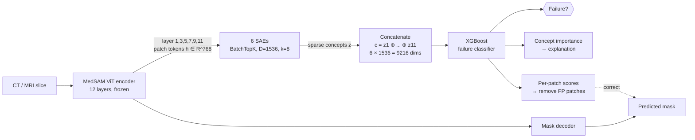

# 🧠 SAE Paper Vault — Home

> [!abstract] One-sentence summary
> The authors open up a medical image segmentation model (MedSAM, a Vision Transformer), use **Sparse Autoencoders** to break its internal activations into ~1,500 interpretable "concepts" per layer, and show that when the model is about to produce a **wrong cancer mask**, fewer concepts fire and they fire more weakly. A small XGBoost classifier on these concepts **detects failures better than confidence scores**, **explains** them in clinical terms, and can **fix** false-positive regions patch by patch.

## How to read this vault

Read top to bottom if you're new to the field. Skip to **Part 2** if you already know SAEs.

### Part 1: Background (what you need first)
1. [[Mechanistic Interpretability]]: what the field is and why it exists
2. [[Superposition and Polysemanticity]]: the problem SAEs solve
3. [[Sparse Autoencoders]]: the main tool, explained in detail
4. [[TopK and BatchTopK SAEs]]: the SAE variant this paper uses
5. [[Toy SAE From Scratch]]: a runnable numpy SAE with results
6. [[Vision Transformers and MedSAM]]: the model being dissected
7. [[Evaluation Metrics]]: Dice, F1, AUROC, AUPR, FPR95, Cohen's d

### Part 2: The paper
1. [[01 Paper Overview]]: the big picture and the "Feeling of Error" idea
2. [[02 The Problem - Silent Failures]]: why confidence scores aren't enough
3. [[03 Key Findings]]: Findings 1 & 2, the evidence that a "machine FOE" exists
4. [[04 Method - Failure Representation]]: SAEs on 6 layers, concatenated
5. [[05 Method - Failure Classifier]]: XGBoost on concepts, plus importance scores
6. [[06 Concept Localization and Failure Correction]]: patch-level maps and mask repair
7. [[07 Experiments and Results]]: datasets, baselines, main numbers, zero-shot
8. [[08 Ablations and Overhead]]: what matters, and what it costs
9. [[09 Causal Evidence]]: steering concept #469 changes the output
10. [[10 Critical Analysis]]: strengths, weaknesses, open questions

### Reference
- [[Glossary]]

## The whole paper in one diagram

## Key numbers at a glance

| What | Result |
|---|---|
| Separation of success vs failure in concept space | p < 1e-5, Cohen's d ≈ 1.8 (PI-CAI) |
| Failure-detection F1, PI-CAI (all layers, XGBoost) | **63.5** with DSC **50.1** |
| Zero-shot AUROC on unseen Prostate158 | **73.6** vs ≤ 53.1 for confidence baselines |
| Routine overhead (6 SAE encoders) | **+3.7 %** latency, +60 MB GPU memory |
| Amplifying "tumor" concept #469 ×2 | DSC drops by **0.173** (causal evidence) |

![[fig_paper_fig2_success_vs_failure.png]]
