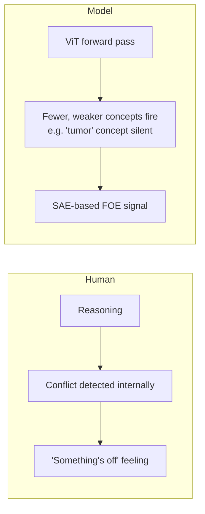
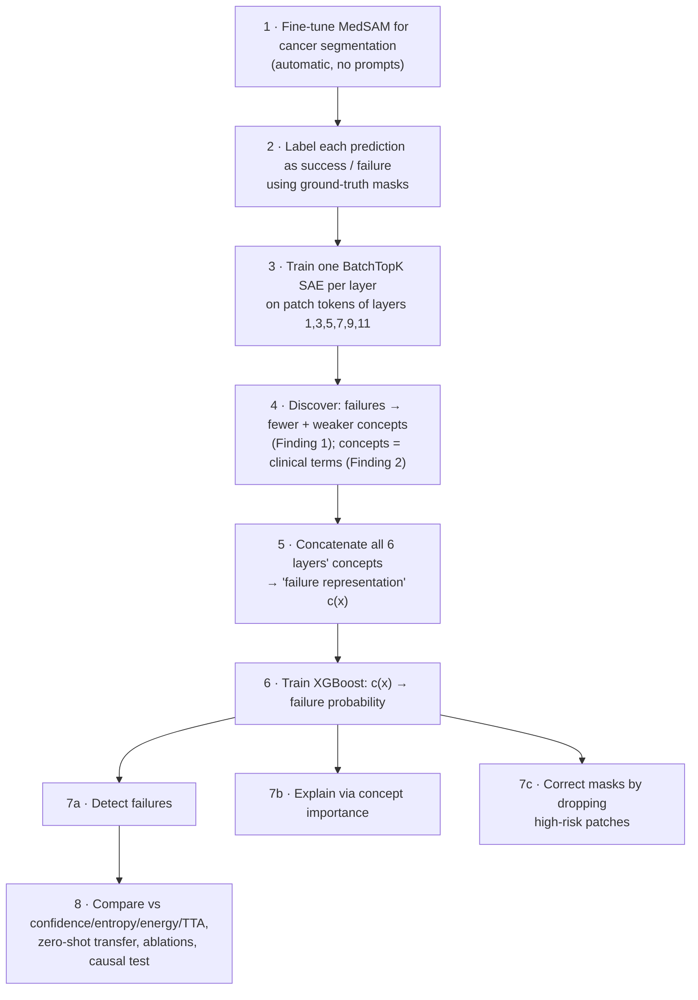

# 01 · Paper Overview: "Medical AI Encodes a Feeling of Error"

Back to [[00 Home]] · Next: [[02 The Problem - Silent Failures]]

---

| | |
|---|---|
| **Title** | Medical AI Encodes a "Feeling of Error": Verifying Cancer Segmentation via Internal Concepts |
| **arXiv** | 2609.08879v1 (cs.CV), 8 Sep 2026 |
| **Authors** | Mengmeng Ma, Yunxiang Peng, Tang Li, Lu Lin, Binsheng Zhao, Oguz Akin, Xi Peng |
| **Institutions** | University of Virginia · University of Delaware · Memorial Sloan Kettering Cancer Center |
| **Code** | github.com/deep-real/CancerSegFailure |
| **Cancers** | Prostate (MRI), pancreatic (CT), brain (MRI, appendix) |

## 1. The central question

> **Do AI models "know" when they are wrong, and if so, can we use that signal to predict their own failures?**

## 2. The "Feeling of Error" analogy

In psychology, the **Feeling of Error (FOE)** is the spontaneous sense of unease you get while reasoning when something doesn't add up, before you can say what's wrong. The brain has a measurable correlate: the *error-related negativity* EEG signal.

The paper asks whether a segmentation network has a machine version: an **internal state** that shows up when it's about to be wrong, **even when its output looks confident**.

## 3. What they did, step by step

## 4. The three contributions (as claimed)

1. **Beyond logits.** Internal concept representations can both *detect* and *explain* segmentation failures in clinical terms.
2. **A method.** Extract failure-predictive concepts across layers, then find diagnostic patterns with an interpretable classifier.
3. **Evidence.** Better failure detection than output-based methods on prostate and pancreatic cancer (plus brain in the appendix) **while keeping segmentation quality**.

## 5. Headline results

- Success and failure cases separate strongly in concept space (**p < 1e-5, Cohen's d ≈ 1.8**).
- Beats the **Pareto front** of output-based baselines: higher F1 *and* higher DSC at the same time.
- **Zero-shot** to an unseen dataset: AUROC **73.6** vs ~50 (random) for confidence baselines.
- Top concepts used by the detector are **tumor-related**, plus anatomical context (gland margin, outside gland).
- **Causal:** amplifying the "tumor" concept #469 drops DSC by 0.173. Controls don't.
- Cheap: **+3.7 %** latency for routine use.

## 6. Map of the rest of this vault

| Note | Paper section |
|---|---|
| [[02 The Problem - Silent Failures]] | §1, Fig. 1 |
| [[03 Key Findings]] | §2, Figs. 2–3 |
| [[04 Method - Failure Representation]] | §3.1, Eq. 2 |
| [[05 Method - Failure Classifier]] | §3.2, Eq. 3 |
| [[06 Concept Localization and Failure Correction]] | §3.3, Eqs. 4–5, Fig. 7 |
| [[07 Experiments and Results]] | §4.1–4.3, Figs. 5–8, Table 1, App. A |
| [[08 Ablations and Overhead]] | §4.4, Tables 2–5, App. C (TTA) |
| [[09 Causal Evidence]] | App. C, Table 6, Fig. 12 |
| [[10 Critical Analysis]] | my assessment |
