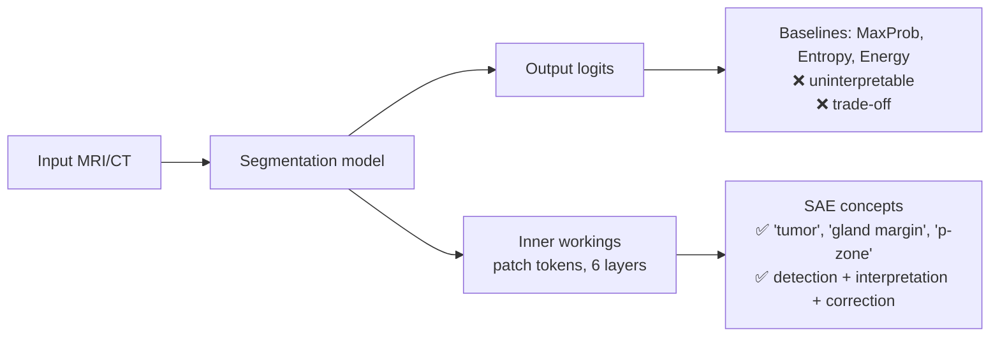

# 02 · The Problem: Silent Failures & Why Confidence Isn't Enough

Back to [[00 Home]] · Previous: [[01 Paper Overview]] · Next: [[03 Key Findings]]

---

## 1. Silent failure

A cancer segmentation model can output a mask that is **anatomically plausible but wrong**:
- a **hallucinated lesion** where there is no tumor → unnecessary biopsy
- a **missed** or badly **mis-bounded** tumor → missed finding or wrong treatment margin

The model doesn't raise an alarm. Clinicians are the last line of defense, but checking every AI mask under heavy workload is a real burden (the paper cites radiologist burnout work).

## 2. The standard fix: output-level uncertainty

Use statistics of the model's output probabilities as a "feeling of error":

| Baseline | Score | Intuition |
|---|---|---|
| **MaxProb** | max softmax probability | low max → unsure |
| **MeanProb** | mean softmax probability over the mask | low mean → unsure |
| **Entropy** | $-\sum p \log p$ | high entropy → unsure |
| **Energy** | $-\log\sum e^{\text{logit}}$ | energy-based OOD score |
| **Direct thresholding** | threshold on probability | simplest |
| **TTA** (appendix) | 1 − mean pairwise DSC across 6 augmented predictions | disagreement → unsure |

All are **post-hoc** and need no retraining. The paper keeps this constraint: hospitals usually receive models as frozen vendor systems.

## 3. Two fundamental limits of output-level cues

### Limit 1: Not actionable
A number like "entropy = 1.13" says the mask is risky. It doesn't say **why** (missed tumor? confused zone? artifact?) or **where**.

### Limit 2: The sensitivity–quality trade-off
To catch more failures you lower the threshold. That flags many **borderline but clinically acceptable** masks too. If flagged masks get "corrected" (discarded or edited), good predictions are lost and overall DSC **drops**.

> In the paper's experiments: **a 20-point gain in failure-detection F1 via these proxies costs an 8–10 point drop in DSC.**

![[12_tradeoff_schematic.png]]

*(Schematic. The baseline curve shape is illustrative. The paper's real Fig. 5 plots each baseline at thresholds 0.5–0.8 and draws the Pareto front. "Ours" uses the paper's PI-CAI numbers.)*

## 4. The authors' reframing

> "A model's feeling of error is likely encoded not in **what it outputs**, but in **how it thinks**."

So instead of reading the final logits, read the **intermediate representations** with mech-int tools, specifically [[Sparse Autoencoders]].

> [!question] Why would internals be better than outputs?
> The output is a heavily compressed summary: for each pixel, "tumor or not". Many internal states map to the same output. A confident "tumor" pixel can come from a rich, consistent set of evidence (tumor concept + zone context + texture) or from a thin, odd one. Only the internals tell these apart.
