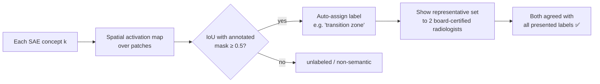

# 03 · Key Findings: Evidence for a "Machine Feeling of Error"

Back to [[00 Home]] · Previous: [[02 The Problem - Silent Failures]] · Next: [[04 Method - Failure Representation]]

---

Before building any detector, the authors trained SAEs on MedSAM's internal activations and looked at what they saw. Two findings motivate everything else.

---

## Finding 1: Failure cases have a distinct internal signature

> [!important] The core observation
> **Failed segmentations activate *fewer* SAE concepts, with *lower* activation magnitudes, than successful ones.**

Two simple summary statistics per case:
1. **Number of active concepts** (activation > 0)
2. **Mean concept activation value**

On PI-CAI (prostate MRI) both separate success from failure with **p < 1e-5** and **Cohen's d > 1.8**: a very large effect.

![[04_cohens_d.png]]

*(Illustrative normal curves at the reported effect sizes. On the unseen Prostate158 data the gap shrinks to d ≈ 1.2 but stays significant; see [[07 Experiments and Results]].)*

The authors' reading: *"failures are not merely low-confidence predictions but correspond to a qualitatively different internal state."* The model, in a sense, "knows" it's wrong even when the output says otherwise.

### Seeing it on real cases (paper Fig. 2)

![[fig_paper_fig2_success_vs_failure.png]]

| Concept | Success case | Failure case | Interpretation |
|---|---|---|---|
| #469 **"tumor"** | 0.10, fires on the lesion | **0.00, silent** | The model's tumor detector never fired, yet a mask was drawn |
| #968 **"peripheral zone"** | 0.15 | 0.70 | Anatomy concepts fire in both: context is fine |
| #204 **"transition zone"** | 0.15 | 0.67 | Same |
| #1097 **"anterior"** | 0.00 | 0.04 | — |

The failure mask is a **false positive**: the model outlined a region, but its internal "tumor" concept never activated. The anatomical context was recognized; the evidence for cancer wasn't there. **That mismatch is the feeling of error.**

### Per-concept predictive power (paper Fig. 3)

For each concept, use its activation alone as a score and compute AUROC against the success/failure labels:

![[05_concept_auroc_by_layer.png]]

Two kinds of concepts emerge:
- **Success-predictive** (AUROC > 0.5, blue): strongly active when segmentation is correct, e.g. #469 "tumor" in layer 11 (+0.205 → AUROC ≈ 0.705).
- **Failure-predictive** (AUROC < 0.5, orange): *more* active when the model fails, e.g. #1282 in layer 11, #698 in layer 7.

Patterns across depth:
| Depth | Observation |
|---|---|
| **Early (L3)** | weakest discriminative power |
| **Mid (L7)** | most **failure-predictive** concepts (4 of top-5) |
| **Deep (L11)** | strongest overall, dominated by success-predictive tumor concepts |

Appendix Fig. 11 repeats this for layers 1, 5, 9 with the same pattern: layer 9 strongest (|AUROC − 0.5| ≈ 0.10–0.13), layer 5 rich in FP-predictive concepts.

> [!note] Why does this matter for method design?
> No single layer or concept tells the whole story. Mid layers flag *what's wrong*, deep layers confirm *what's right*. So the method **combines all layers** ([[04 Method - Failure Representation]]) and uses a **non-linear classifier** that can learn combinations ([[05 Method - Failure Classifier]]).

---

## Finding 2: SAE concepts align with clinical terms

The SAE latents aren't just statistically useful. Many correspond to **real anatomy and pathology**.

### Two-stage validation protocol

### Examples of discovered concepts
| Domain | Concepts found |
|---|---|
| Prostate MRI | tumor, tumor in transition zone, tumor spanning TZ & PZ, partial tumor, peripheral zone, transition zone, gland margin, outside the gland, anterior; tumor **core** vs tumor **edge** |
| Pancreatic CT | pancreatic tumor, pancreas, pancreas head, kidneys, liver |
| Brain MRI (App. A) | enhancing, necrotic, edema, margin |

![[fig_paper_fig4_pants_concepts.png]]

![[fig_paper_fig10_brain_concepts.png]]

> [!warning] Not every concept is nameable
> The paper notes that *"some of the most predictive failure concepts we discover are non-semantic"*: internal processing patterns with no radiology name. The authors see this as a feature, citing the argument that AI may develop representations outside our existing vocabulary. It also means the "explanation" is only partly human-readable.

---

## Open problems the findings raise (→ the method)

1. **Which concepts?** 1K–10K concepts per layer is too many to inspect by hand.
2. **How to combine them?** Information is spread across layers, and failures may depend on *interactions* (e.g. "hyperintense + irregular texture + weak boundary = likely failure").

These lead directly to [[04 Method - Failure Representation]] and [[05 Method - Failure Classifier]].
