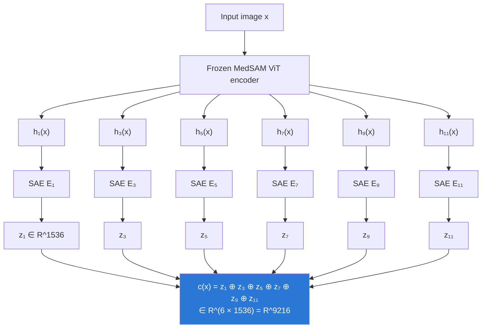

# 04 · Method Part 1: Building the "Failure Representation"

Back to [[00 Home]] · Previous: [[03 Key Findings]] · Next: [[05 Method - Failure Classifier]]

---

> [!question] Question answered here (§3.1)
> **How do we capture *all* potential failure signals?**

## 1. Why multiple layers

Failures have different causes, and each cause shows up at a different depth:

| Failure cause | Example | Where it should show up |
|---|---|---|
| Low-level image problems | motion, noise, poor contrast | **early** layers (visual features) |
| Mid-level structure | ambiguous boundaries, odd texture | **mid** layers |
| High-level semantic confusion | benign tissue read as malignant, irregular morphology | **deep** layers |

So instead of hunting for one "best" layer, take **all** of them.

## 2. Pipeline

## 3. Formally

- Layers: $L = \{1, 3, 5, 7, 9, 11\}$, spread uniformly across the 12-block ViT
- For each layer $l$: embedding $\mathbf{h}_l(x) \in \mathbb{R}^d$, $d = 768$
- One **independent SAE per layer**, encoder $E_l: \mathbb{R}^d \to \mathbb{R}^D$, $D = 1536$
- Each SAE is trained on embeddings from **both** correct and failed predictions: $\{\mathbf{h}_l(x) \mid x \in X_C \cup X_F\}$. This matters: an SAE trained only on successes might not have latents for failure-specific states.
- Sparse concepts: $\mathbf{z}_l(x) = E_l(\mathbf{h}_l(x))$

**Eq. (2), the holistic failure representation:**
$$
\mathbf{c}(x) = \bigoplus_{l \in L} \mathbf{z}_l(x) = \bigoplus_{l \in L} E_l(\mathbf{h}_l(x)) \in \mathbb{R}^{|L| \cdot D}
$$

$\oplus$ = concatenation, $|L| = 6$, so $\mathbf{c}(x)$ has **9,216** dimensions, but it's **very sparse** (≈ 8 active per layer per patch → ≈ 48 non-zeros per patch).

## 4. Sanity check before going further

Is $\mathbf{c}(x)$ actually discriminative? Fig. 2 (left) shows the success vs failure distributions of concept count and mean activation: independent t-test **p < 1e-5**, effect size **d > 1.8**. Yes. See [[03 Key Findings]].

## 5. Design choices worth noticing

| Choice | Reason | Alternative |
|---|---|---|
| Patch-level SAE input | segmentation is per-pixel, so keep spatial info | image-level pooling (common in classification SAEs) |
| Separate SAE per layer | each layer has its own "vocabulary" | one shared/universal SAE (named as future work) |
| Concatenate, don't select | let the classifier decide what matters | hand-pick a layer |
| Base model **frozen** | post-hoc, vendor-model setting | train with a failure head (excluded on purpose) |

> [!note] Image-level vs patch-level c(x)
> §3.1–3.2 describe $\mathbf{c}(x)$ per **image** (for the image-level failure decision), while §3.3 uses $\mathbf{c}(x)_{ij}$ per **patch** for correction. The paper doesn't spell out how patch concepts are pooled into the image-level vector (e.g. mean or max over the mask region). Worth checking in the code. See [[10 Critical Analysis]].

Next: how this 9,216-dim vector becomes a decision → [[05 Method - Failure Classifier]]
