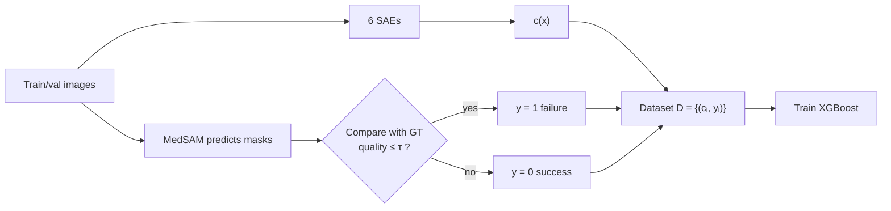

# 05 · Method Part 2: The Failure Classifier & Concept Importance

Back to [[00 Home]] · Previous: [[04 Method - Failure Representation]] · Next: [[06 Concept Localization and Failure Correction]]

---

> [!question] Question answered here (§3.2)
> **How do we find predictive patterns of failure** in the 9,216-dim concept vector, while staying interpretable?

## 1. Two goals for the decision function

$$
g: \mathbb{R}^{|L| \cdot D} \to [0, 1], \qquad p_{\text{failure}}(x) = g(\mathbf{c}(x))
$$

1. **Accurate:** high discrimination between success and failure
2. **Interpretable:** provides importance scores $\mathbf{w} \in \mathbb{R}^{|L| \cdot D}$ saying how much each concept contributes

## 2. Building the failure dataset

$$
\mathcal{D} = \{(\mathbf{c}_i, y_i)\}_{i=1}^{N}, \quad y_i = \begin{cases} 0 & \text{correct prediction} \\ 1 & \text{failure} \end{cases}
$$

Built from the **segmentation model's own training and validation sets**, where ground truth exists, so failure labels are reliable.

## 3. Training objective, Eq. (3)

Standard regularized binary cross-entropy:

$$
\min_g \; -\frac{1}{N}\sum_{i=1}^{N}\Big[y_i \log g(\mathbf{c}_i) + (1-y_i)\log(1-g(\mathbf{c}_i))\Big] + \lambda\,\Omega(g)
$$

$\Omega(g)$ controls complexity (for XGBoost: tree count/depth/leaf weights). $\lambda \ge 0$ sets its strength.

## 4. Why XGBoost?

| Property | Why it fits |
|---|---|
| Handles **high-dimensional sparse** features | $\mathbf{c}(x)$ is 9,216-dim and mostly zeros |
| Learns **non-linear interactions** across concepts and layers | failures may be "concept A on AND concept B off" |
| Built-in **feature importance** | maps straight back to (layer, concept-id) |

Compared in Table 4 ([[08 Ablations and Overhead]]): XGBoost > logistic regression > decision tree > random forest.

> [!example] The kind of rule it can learn
> "hyperintense + irregular texture + weak boundaries = likely failure". No single concept is suspicious, but the **combination** is.

## 5. From importance scores to explanations

Each importance score belongs to one dimension of $\mathbf{c}(x)$, i.e. one **(layer, concept)** pair. Combined with each concept's label ([[03 Key Findings]]) and spatial map ([[06 Concept Localization and Failure Correction]]), you get statements like this (my illustrative wording, not a quote from the paper):

> *"Flagged as likely failure mainly because layer-11 concept #1029 ('partial tumor') and #241 ('tumor in transition zone') are weak, and layer-9 #1423 ('gland margin') is unusual."*

### The top-5 concepts the detector relies on (paper Fig. 8, PI-CAI)

![[11_concept_importance.png]]

![[fig_paper_fig8_concept_heatmaps.png]]

| Rank | Layer, ID | Label | Importance |
|---|---|---|---|
| 1 | L11 #1029 | tumor (partial) | 0.050 |
| 2 | L11 #241 | tumor in transition zone | 0.045 |
| 3 | L11 #469 | tumor in transition & peripheral zone | 0.031 |
| 4 | L9 #1423 | gland margin | 0.025 |
| 5 | L5 #478 | outside the gland | 0.021 |

**Reading:** the detector mainly checks whether the model's **tumor evidence** (deep layers) is present and consistent, and uses **anatomical context** (gland edge, extra-prostatic region) from mid/deeper layers to judge plausibility. This matches how a radiologist would sanity-check a lesion call.

> [!tip] Connection to mech int
> This classifier is basically a **probe**, but on SAE features instead of raw neurons. That's what makes its weights interpretable: "concept #241" means something, "neuron 412" doesn't.
