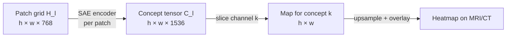
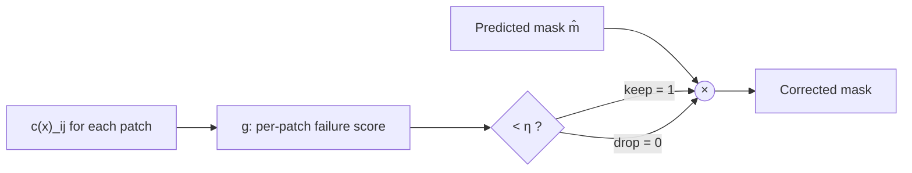

# 06 · Concept Localization & Patch-Level Failure Correction

Back to [[00 Home]] · Previous: [[05 Method - Failure Classifier]] · Next: [[07 Experiments and Results]]

---

## 1. Where does a concept live? (Eq. 4)

Because the SAEs run on **patch tokens**, every concept has a spatial map.

At layer $l$, the ViT outputs a grid $\mathbf{H}_l(x) \in \mathbb{R}^{h \times w \times d}$. Apply the SAE encoder to **every patch**:

$$
\mathbf{C}_l(x) = E_l(\mathbf{H}_l(x)) \in \mathbb{R}^{h \times w \times D}
$$

- $\mathbf{C}_l(x)[i, j, :] \in \mathbb{R}^D$: concept vector of patch $(i, j)$
- $\mathbf{C}_l^{(k)}(x) = \mathbf{C}_l(x)[:, :, k] \in \mathbb{R}^{h \times w}$: the **activation map of concept $k$**, upsampled and overlaid on the scan

These are the heatmaps in every figure (Figs. 2, 4, 7, 8, 10, 13), and they're how concepts got labeled (IoU ≥ 0.5 with annotations).

## 2. Failure correction (Eq. 5)

Output-based methods can only say "this **whole** mask is suspicious": keep it or throw it all away. That loses the correct parts.

Here the classifier is applied **per patch** using that patch's concept vector, and only high-risk patches are removed:

$$
\hat m_{\text{corrected}}(i,j) = \hat m(i,j) \cdot \mathbb{1}\!\left[g\big(\mathbf{c}(x)_{ij}\big) < \eta\right]
$$

- keep patch $(i, j)$ of the predicted mask **only if** its local failure score is below threshold $\eta$
- this is a **patch-retention** problem: it can only *remove* false-positive area, never add missed tumor

### Results on real cases (paper Fig. 7)

![[fig_paper_fig7_correction_mri.png]]

![[fig_paper_fig7_correction_ct.png]]

![[fig_paper_fig4_pants_correction.png]]

![[10_correction_and_tta.png]]

| Case | DSC before | DSC after | Gain |
|---|---|---|---|
| PI-CAI ex. 1 (MRI) | 74.1 | 86.5 | +12.4 |
| PI-CAI ex. 2 (MRI) | 78.5 | 85.0 | +6.5 |
| PanTS ex. 1 (CT) | 29.3 | 40.7 | +11.4 |
| PanTS ex. 2 (CT) | 54.5 | 68.9 | +14.4 |
| PanTS (Fig. 4) | 38.6 | 66.2 | +27.6 |

Brain tumor cases (Appendix Fig. 13): 38.3→64.1, 75.9→85.2, 74.1→80.1, 57.3→68.3, 78.6→84.1, 70.1→84.6.

![[fig_paper_fig13_brain_correction.png]]

> [!note] Two kinds of failure detected (§4.3)
> 1. **Hallucinated lesions:** the model predicts a tumor that doesn't exist.
> 2. **Boundary errors:** a real lesion, but badly over- or under-segmented.
> Patch-level correction helps with hallucinations and **over**-segmentation. It can't fix under-segmentation (it never adds pixels).

> [!warning] These are selected examples
> The per-case DSC gains are qualitative illustrations. Aggregate effects are in [[07 Experiments and Results]] (DSC 50.1 overall on PI-CAI).
