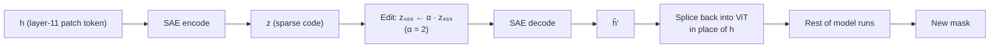
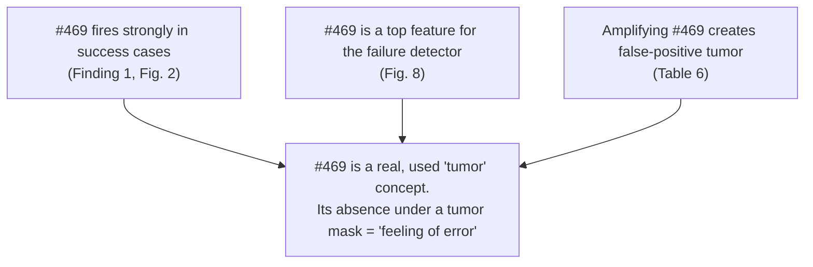

# 09 · Causal Evidence: Steering the "Tumor" Concept

Back to [[00 Home]] · Previous: [[08 Ablations and Overhead]] · Next: [[10 Critical Analysis]]

---

## 1. Why this experiment matters

Everything up to here is **correlational**: concept #469 *co-occurs* with tumors and with success. A skeptic could say the SAE found a direction that tracks tumors but that the model **doesn't use**. The mech-int standard for "the model uses this feature" is an **intervention**: change the feature, watch the output change.

## 2. The intervention (Appendix C)

For every patch at **layer 11**:

Three conditions, DSC compared to the raw model:

| Intervention | Δ DSC vs raw |
|---|---|
| SAE round-trip only (encode → decode, no edit) | **+0.013** |
| Amplify a **random non-tumor** latent (α = 2) | **+0.035** |
| Amplify **#469, tumor-related** (α = 2) | **−0.173** |

![[09_causal_intervention.png]]

![[fig_paper_fig12_amplification.png]]

## 3. Interpretation

- **Amplifying #469 makes the model see more tumor.** It adds false positives and drops DSC sharply (0.409 → 0.200 and 0.710 → 0.339 in the two examples).
- The two **controls** don't hurt, so the damage is specific to the tumor concept, not to editing in general.
- Conclusion: #469 is **causally upstream** of the tumor prediction, not just correlated with tumor regions.

> [!note] Surprising side-result
> Passing activations through the SAE **without editing** slightly *improves* DSC (+0.013). The authors suggest sparse reconstruction may act as a **denoiser**: dropping the small leftover components removes some noise. (The random-latent control giving +0.035 is a bit odd and may be within noise; the paper doesn't report variance.)

## 4. How this ties the story together

## 5. What's still missing (the authors say so too)

- Only **one** concept, **one** layer, **one** α tested.
- No **ablation** (setting #469 → 0) to test necessity, which would show whether removing it erases true tumors.
- No full **circuit**: *how* does #469 at layer 11 reach the mask decoder?
- The limitations section proposes **causal mediation analysis** and **causal abstraction** as next steps. See [[10 Critical Analysis]].
