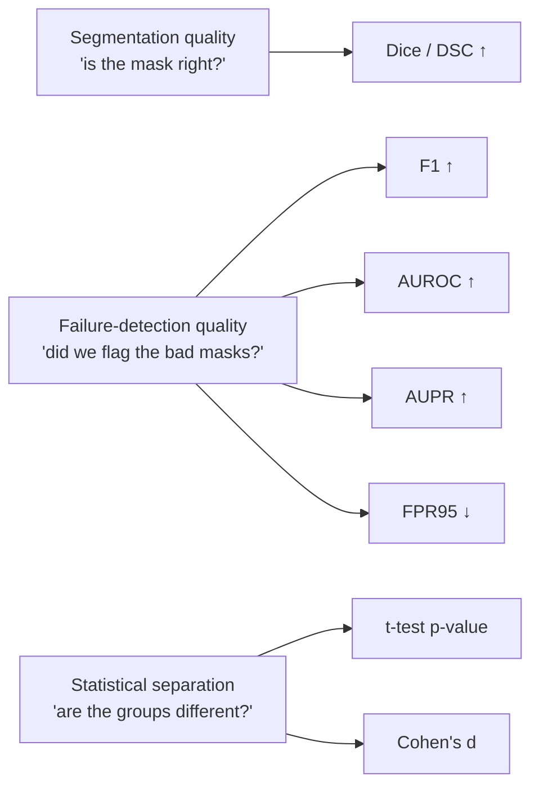

# Evaluation Metrics used in the paper

Back to [[00 Home]] · Previous: [[Vision Transformers and MedSAM]] · Next: [[01 Paper Overview]]

---

The paper measures **two different things**. Keep them apart:

## Dice Similarity Coefficient (DSC), segmentation
$$
\mathrm{DSC}(\hat m, m) = \frac{2\,|\hat m \cap m|}{|\hat m| + |m|} \in [0, 1]
$$
1 = perfect overlap, 0 = none. Reported as a % (e.g. 50.1). In this paper, DSC is measured **after** failure handling: flagged failures get corrected or removed. So a detector that flags too much can *lower* DSC. That's the trade-off in [[02 The Problem - Silent Failures]].

> [!note] What counts as a "failure"
> Definition 1: a failure is when $E(\hat m, m) \le \tau$ for a quality metric $E$ (e.g. Dice) and threshold $\tau$. In the experiments, failures are discussed largely as **false-positive** masks (TP vs FP labels). The exact $\tau$ isn't stated in the text.

## F1, failure detection (the primary metric)
Treat "failure" as the positive class.
$$
F_1 = \frac{2 \cdot \text{precision} \cdot \text{recall}}{\text{precision} + \text{recall}}
$$
Needs a decision threshold. Balances catching failures (recall) against false alarms (precision).

## AUROC
Area under the ROC curve (TPR vs FPR over all thresholds). **0.5 = random**, 1.0 = perfect ranking. Threshold-free. The paper also computes AUROC **per single concept** (Fig. 3): using one concept's activation as the score. AUROC > 0.5 means "more activation → more likely success"; AUROC < 0.5 means "more activation → more likely failure".

## AUPR
Area under the precision-recall curve. More informative than AUROC when classes are imbalanced. The random baseline equals the positive-class rate (not 0.5).

## FPR95
Conventionally: the **false-positive rate when the true-positive rate is 95 %**. Lower is better. Baselines scoring 100 % means: to catch 95 % of failures, they must flag *every* good case too.
> The paper's text says "True Positive Rate at 95% False Positive Rate (FPR95, ↓)", which looks like a wording slip; the ↓ arrow and values fit the standard definition.

## Statistical separation: t-test & Cohen's d
- **Independent t-test p-value**: how surprising the difference in means would be if there were no real difference. p < 1e-5 → very unlikely to be chance.
- **Cohen's d** = (mean₁ − mean₂) / pooled std. A size of effect, independent of sample size. Rule of thumb: 0.2 small, 0.5 medium, 0.8 large. **d ≈ 1.8 is huge.**

![[04_cohens_d.png]]

With d = 1.8, the two distributions overlap only a little. A random success case beats a random failure case ~90 % of the time (that probability is Φ(d/√2) ≈ 0.90).
