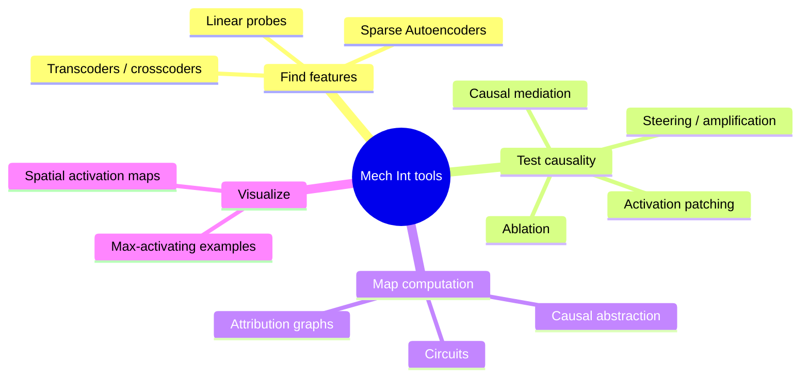
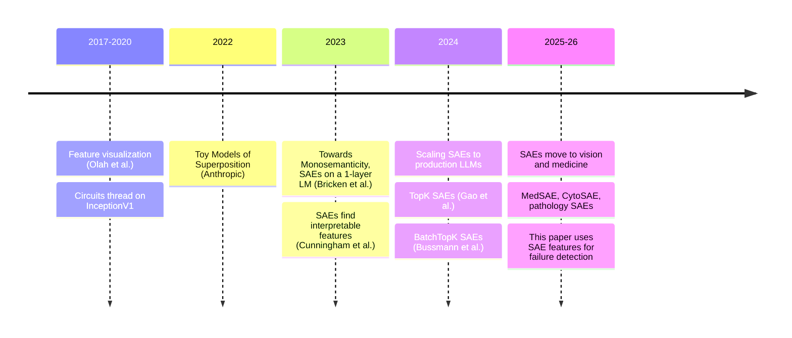

# Mechanistic Interpretability (Mech Int)

> [!summary] In one line
> Mechanistic interpretability tries to **reverse-engineer a trained neural network** into human-understandable parts: what *variables* (features) it computes internally, and what *algorithms* (circuits) connect them. The goal is to understand *how* it reaches its output, not only *what* the output is.

Back to [[00 Home]]

---

## 1. Why we need it

A neural network is a big pile of matrices. It works, but nobody wrote down *how* it works: the "program" was found by gradient descent. This is a problem when:

- **The stakes are high.** In medicine a confident wrong mask can mean a missed cancer or an unnecessary biopsy. See [[02 The Problem - Silent Failures]].
- **Outputs look fine but are wrong.** A segmentation mask can be anatomically plausible and still incorrect.
- **We want to fix, not just flag.** Knowing *which internal concept* went wrong tells you *why* it failed and *where* to intervene.

Classic interpretability tools (saliency maps, Grad-CAM, Integrated Gradients) answer "which input pixels mattered?". Mech int asks a deeper question: **"what did the model compute from those pixels, and how?"**

## 2. The analogy: decompiling a binary

| Software reverse engineering | Mechanistic interpretability                                        |
| ---------------------------- | ------------------------------------------------------------------- |
| Compiled binary              | Trained weights                                                     |
| CPU registers / memory       | Activations (the residual stream, patch tokens)                     |
| Variables                    | **Features**: directions in activation space that mean something    |
| Functions                    | **Circuits**: groups of weights that compute features from features |
| Decompiler                   | SAEs, probes, activation patching, attribution graphs               |

## 3. Core ideas

### 3.1 Features
A **feature** is a property of the input that the network represents internally: "this patch is tumor", "this is the gland edge", "this is a horizontal edge". In mech int, features are usually assumed to be **directions** in activation space.

### 3.2 The Linear Representation Hypothesis
The working assumption: an activation vector $\mathbf{h} \in \mathbb{R}^d$ is (roughly) a **sparse, linear combination** of feature directions:

$$
\mathbf{h} \approx \sum_{i} z_i \, \mathbf{w}_i + \mathbf{b}
$$

where $\mathbf{w}_i$ is the direction for feature $i$ and $z_i \ge 0$ says how strongly it's present. Most $z_i$ are zero for any given input. **This equation is exactly the decoder of a [[Sparse Autoencoders|Sparse Autoencoder]].**

### 3.3 Polysemanticity and superposition
If each neuron were one feature, we could read the network neuron by neuron. In practice, neurons are **polysemantic**: one neuron fires for several unrelated things. The leading explanation is **superposition**: the network packs *more features than it has dimensions*. Full explanation in [[Superposition and Polysemanticity]].

### 3.4 Circuits
Once features are found, you can ask how features in layer $l$ are computed from features in layer $l-1$. That wiring is a **circuit**. (This paper stops at features; its limitations section names circuit-level causal analysis as future work. See [[10 Critical Analysis]].)

## 4. The mech-int toolbox

| Tool | Question it answers | Used in this paper? |
|---|---|---|
| **Sparse Autoencoder (SAE)** | What features does this layer represent? | ✅ the core tool |
| **Linear probe** | Is property X linearly decodable here? | ≈ (the XGBoost failure classifier is a probe on SAE features) |
| **Spatial activation maps** | Where in the image does feature $k$ fire? | ✅ [[06 Concept Localization and Failure Correction]] |
| **Steering / amplification** | Does feature $k$ *cause* the output? | ✅ [[09 Causal Evidence]] |
| **Activation patching / causal mediation** | Which components carry the effect? | ❌ named as future work |

## 5. Brief history

## 6. Where this paper fits

Most SAE work is **descriptive**: "look, here is a feature for X". This paper is **applied** mech int. It uses SAE features as a *sensor* for model reliability, which it calls a "Feeling of Error". See [[01 Paper Overview]].

> [!tip] Key takeaway
> Mech int treats a network's hidden state as a message written in an unknown language. SAEs are the dictionary. This paper finds that when the model is wrong, the message contains **fewer and quieter words**.

Next: [[Superposition and Polysemanticity]]
