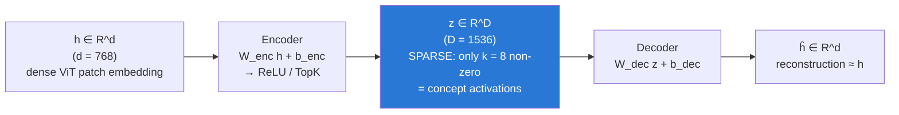
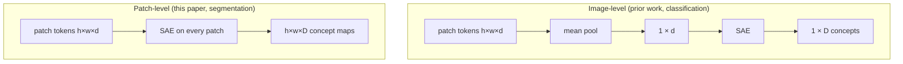

# Sparse Autoencoders (SAEs)

Back to [[00 Home]] · Previous: [[Superposition and Polysemanticity]] · Next: [[TopK and BatchTopK SAEs]]

---

> [!summary] In one line
> An SAE is a small two-layer network trained to **rewrite** a model's dense activation vector $\mathbf{h}$ as a **sparse** combination of a large set of learned directions. Each direction ideally means one human-understandable **concept**.

## 1. Architecture

The paper's Eq. (1):

$$
\mathbf{z} = E(\mathbf{h}) = \mathrm{ReLU}(\mathbf{W}_{\text{enc}}\mathbf{h} + \mathbf{b}_{\text{enc}}), \qquad
\hat{\mathbf{h}} = G(\mathbf{z}) = \mathbf{W}_{\text{dec}}\mathbf{z} + \mathbf{b}_{\text{dec}}
$$

- $\mathbf{h} \in \mathbb{R}^d$: an activation taken from inside the ViT (here, one **patch token** at one layer)
- $D > d$: the dictionary is **overcomplete** (more concepts than dimensions; see [[Superposition and Polysemanticity]])
- $\mathbf{z} \in \mathbb{R}^D$: the **sparse code**. $z_i$ = "how much of concept $i$ is present"
- Column $\mathbf{w}_i$ of $\mathbf{W}_{\text{dec}}$ is concept $i$'s **direction** in activation space

The decoder is literally the linear representation hypothesis:

$$
\hat{\mathbf{h}} = \sum_{i=1}^{D} z_i \mathbf{w}_i + \mathbf{b}_{\text{dec}}
$$

## 2. Training objective

$$
\mathcal{L}(\mathbf{h}) = \underbrace{\lVert \mathbf{h} - \hat{\mathbf{h}} \rVert_2^2}_{\text{reconstruction: keep the information}} \; + \; \underbrace{\lambda \lVert \mathbf{z} \rVert_1}_{\text{sparsity: use few concepts}}
$$

The two terms pull against each other:

| If you only had... | You'd get |
|---|---|
| Reconstruction | A dense code: every concept a little bit on. Not interpretable. |
| Sparsity | All zeros. Nothing reconstructed. |
| **Both** | A few concepts explain each input. These tend to be **monosemantic**. |

> [!note] This paper's variant
> Instead of the L1 penalty, the paper uses **BatchTopK** (Bussmann et al., 2024), which enforces sparsity by keeping only the top activations. On average **k = 8** of **1,536** concepts are active per patch. Details in [[TopK and BatchTopK SAEs]].

## 3. Dense vs sparse: what it looks like

![[03_dense_vs_sparse.png]]

The ViT embedding (top) is dense: every coordinate is non-zero, and no single coordinate means anything clean. The SAE code (bottom) is sparse: a handful of concepts, each with a meaning ("tumor", "peripheral zone", "gland margin"...).

## 4. Does it actually recover the hidden features? (toy demo)

To make this concrete I trained a tiny TopK SAE from scratch on synthetic data. **12 known features** were squeezed into **6 dimensions** (superposition), and the SAE (D = 32, k = 2) had to find them again with no labels:

![[02_toy_sae_recovery.png]]

- **Left:** reconstruction loss falls quickly.
- **Middle:** cosine similarity between each true feature and its best-matching learned latent. The bright diagonal means each true feature got its own latent.
- **Right:** all 12 true features recovered with |cos| > 0.98.

Code and explanation: [[Toy SAE From Scratch]].

## 5. How you interpret a concept

An SAE gives you *latents*, not names. You attach meaning afterwards:

1. **Max-activating examples:** which inputs/patches make $z_i$ largest?
2. **Spatial maps (vision):** apply the encoder to every patch, then plot $z_i$ over the image grid. This paper does exactly this (Eq. 4); see [[06 Concept Localization and Failure Correction]].
3. **Automatic labeling:** the paper computes IoU between a concept's active pixels and annotated masks (lesion, zones, organs). If IoU ≥ 0.5, the concept gets that label.
4. **Human check:** two board-certified radiologists confirmed all presented labels.
5. **Causal test:** amplify or ablate $z_i$ and see if the output changes as predicted ([[09 Causal Evidence]]).

## 6. Patch-level vs image-level SAEs

Classification SAE papers usually **average-pool** patch tokens into one vector per image and train the SAE on that. This paper trains on **individual patch tokens** because segmentation is a per-pixel task. This keeps spatial information, so every concept has a *location*, which later enables patch-level correction.

## 7. Known caveats of SAEs (general)

- **Not unique:** different seeds or sizes give somewhat different dictionaries.
- **Feature splitting:** bigger dictionaries split "tumor" into "tumor core" vs "tumor edge" (the paper sees this: *"finer-grained concepts distinguishing tumor core from edge"*).
- **Dead latents:** some latents never fire. TopK variants help.
- **Reconstruction error:** the SAE doesn't capture 100% of the activation. Whatever is left over is invisible to the analysis.
- **Interpretability ≠ causality:** a latent can correlate with "tumor" without the model using it. Hence [[09 Causal Evidence]].

> [!tip] Key takeaway
> An SAE turns the model's internal language from "768 mixed-up numbers" into "8 out of 1,536 named concepts". The paper's insight is that **the count and strength of those concepts** is itself a reliability signal.
