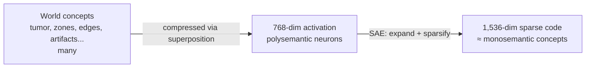

# Superposition & Polysemanticity

Back to [[00 Home]] · Previous: [[Mechanistic Interpretability]] · Next: [[Sparse Autoencoders]]

---

## 1. The puzzle: neurons that mean many things

If you look at one neuron (one coordinate of an activation vector) in a vision model, you often find it fires for **unrelated** things: tumor tissue, some MRI artifact, *and* the edge of the bladder. Such a neuron is **polysemantic**. A neuron that responds to exactly one concept would be **monosemantic**.

Polysemantic neurons make direct interpretation almost useless: "neuron 412 is high" tells you nothing clean.

## 2. The explanation: superposition

> [!important] Superposition hypothesis
> A layer with $d$ dimensions can represent **many more than $d$ features** by assigning each feature a direction that is *almost* (not exactly) orthogonal to the others. It works because **features are sparse**: any single input uses only a few of them, so the small overlaps rarely collide.

![[01_superposition.png]]

- **Left:** 2 dimensions, 2 features. Each gets its own axis. Clean.
- **Right:** 2 dimensions, 5 features. They share space. Every neuron (axis) now carries some of every feature, so every neuron is polysemantic.

### Why the network does this
The real world has far more useful concepts (organs, zones, lesion types, textures, artifacts, boundaries...) than a ViT layer has dimensions (768 in MedSAM's ViT-B). Superposition lets it store them all, at the cost of a little interference.

### Why sparsity makes it work
Suppose "tumor in transition zone" and "outside the gland" share part of a direction. That only causes confusion when **both are active in the same patch**, which is rare. High-dimensional space also helps: in $\mathbb{R}^{768}$ you can fit *exponentially many* nearly orthogonal directions.

## 3. Consequence: we need a decoder

If $\mathbf{h} = \sum_i z_i \mathbf{w}_i$ with many more directions $\mathbf{w}_i$ than dimensions, the basis $\{\mathbf{w}_i\}$ is **overcomplete**. Plain linear algebra (PCA, ICA) can't recover more than $d$ directions. We need a method that:

1. allows **$D > d$** directions (overcomplete dictionary), and
2. **forces sparsity**, so each input is explained by only a few directions.

That method is **sparse dictionary learning**, and its modern neural form is the **[[Sparse Autoencoders|Sparse Autoencoder]]**.

## 4. How this shows up in the paper

> "The SAEs disentangle the polysemantic embeddings into monosemantic ones, which can be treated as the internal concepts." (Sec. 4.2)

The paper expands MedSAM's 768-dim patch embeddings into **1,536 SAE concepts** (2× overcomplete). Many of them line up with radiology terms: peripheral zone, transition zone, gland margin, tumor, pancreas head, kidneys. See [[03 Key Findings]].

> [!note] Interesting detail
> The paper found the best dictionary size was only 2× (1,536), far smaller than the ~10,000+ used for natural images. The authors guess this is because medical images are more **structured**: fewer distinct concepts per anatomy. See [[08 Ablations and Overhead]].
