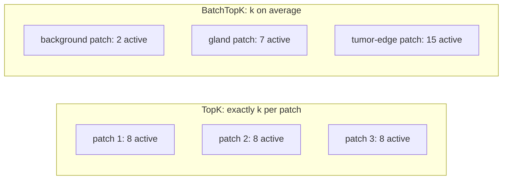

# TopK & BatchTopK SAEs

Back to [[00 Home]] · Previous: [[Sparse Autoencoders]] · Next: [[Toy SAE From Scratch]]

---

## 1. The problem with L1

The original SAE loss uses $\lambda\lVert\mathbf{z}\rVert_1$ for sparsity. It works, but:
- **Shrinkage:** L1 pushes *all* activations toward zero, including the ones that should be large. Magnitudes get biased low.
- **Hard to tune:** you pick $\lambda$, not the sparsity itself. The number of active features per input ($L_0$) then drifts.

## 2. TopK SAE (Gao et al., 2024)

Replace ReLU with a **TopK** activation: for each input, keep only the $k$ largest pre-activations and zero the rest.

$$
\mathbf{z} = \mathrm{TopK}_k\big(\mathbf{W}_{\text{enc}}(\mathbf{h} - \mathbf{b}_{\text{dec}}) + \mathbf{b}_{\text{enc}}\big)
$$

- Sparsity is **exactly** $k$ per input. No $\lambda$ to tune.
- Loss is just reconstruction MSE.
- No shrinkage on the survivors.

## 3. BatchTopK SAE (Bussmann, Leask & Nanda, 2024), used by this paper

TopK forces *every* input to use exactly $k$ concepts, but some patches are simple (background) and some are complex (tumor boundary). **BatchTopK** instead keeps the top $k \times B$ activations **across the whole batch** of $B$ inputs:

- On average, $k$ concepts per patch, but the count can **vary with input complexity**.
- At inference, a learned global threshold replaces the batch operation, so each patch can be encoded on its own.

> [!important] Why this matters for the paper
> Because BatchTopK lets the **number of active concepts vary per input**, "number of active concepts" becomes a meaningful measurement. The paper's main finding is that **failure cases activate fewer concepts with lower magnitudes** ([[03 Key Findings]]). With plain TopK that count would be fixed at $k$ and the signal would vanish.

## 4. The paper's settings

| Hyperparameter | Value |
|---|---|
| Method | BatchTopK |
| Input | patch-level embeddings from ViT layers 1, 3, 5, 7, 9, 11 |
| Input dim $d$ | 768 (MedSAM ViT-B) |
| Dictionary size $D$ | **1,536** (2 × 768) |
| Sparsity $k$ | **8** |
| Learning rate | 1e-4 |
| Epochs | 5 |
| One SAE per layer | yes, 6 independent SAEs |
| Trained on | embeddings from **both** correct and failed predictions |

Ablation (Table 2): k ∈ {4, 8, 16} × D ∈ {1536, 3072}. k = 8, D = 1536 was best. See [[08 Ablations and Overhead]].
