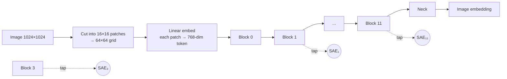

# Vision Transformers & MedSAM (the model being dissected)

Back to [[00 Home]] · Previous: [[Toy SAE From Scratch]] · Next: [[Evaluation Metrics]]

---

## 1. Vision Transformer (ViT) in 60 seconds

- The image becomes a **grid of patch tokens**, each a 768-dim vector.
- Each transformer block mixes information between patches (attention) and transforms each token (MLP).
- After block $l$, the token grid is $\mathbf{H}_l(x) \in \mathbb{R}^{h \times w \times d}$. **This is what the SAEs read.**
- Early blocks hold low-level visual features (edges, intensity, texture). Deep blocks hold semantic ones (organ, lesion). The paper's layer ablation agrees ([[08 Ablations and Overhead]]).

## 2. SAM → MedSAM

**SAM** (Segment Anything) = big ViT image encoder + **prompt encoder** (points/boxes) + light **mask decoder**.
**MedSAM** (Ma et al., *Nature Communications* 2024) = SAM fine-tuned on a large medical image collection.

## 3. What the authors changed (Appendix B)

| Component | Original MedSAM | In this paper |
|---|---|---|
| Image encoder | ViT-B | same, **frozen** during SAE analysis |
| Prompt encoder | needs a human box/point | replaced by an automatic **"overload encoder"** (a ResNet, AutoSAM-style) that makes surrogate prompts from the image |
| Mask decoder | single mask | **multi-class** output (gland, zones, lesion...) |
| Training | — | fine-tuned per cancer dataset, Focal Loss (α = 0.97, γ = 2), Adam, weight decay 1e-4, exponential LR schedule |

So the system runs **fully automatically**: image in, cancer mask out. No clinician prompt needed. That's what makes silent failure dangerous.

## 4. Why a ViT is a good target for SAEs

- Patch tokens keep a **fixed spatial grid**, so every concept activation has an (i, j) location.
- The residual stream has the same width (768) at every layer, so the same SAE design works for all 6 tapped layers.
- Prior work from the same group (concept circuits in ViTs, "Inside-Out" generalization measurement) built the tooling.

> [!note] Layers used
> $L = \{1, 3, 5, 7, 9, 11\}$, uniformly spread across the 12-block encoder to cover **early, mid and deep** processing. See [[04 Method - Failure Representation]].
